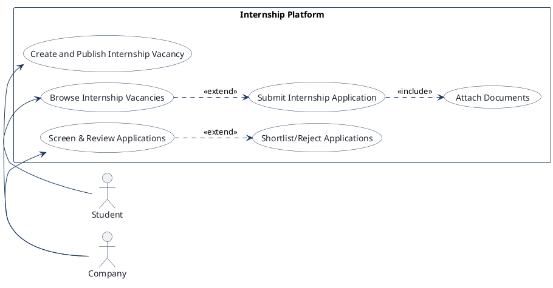
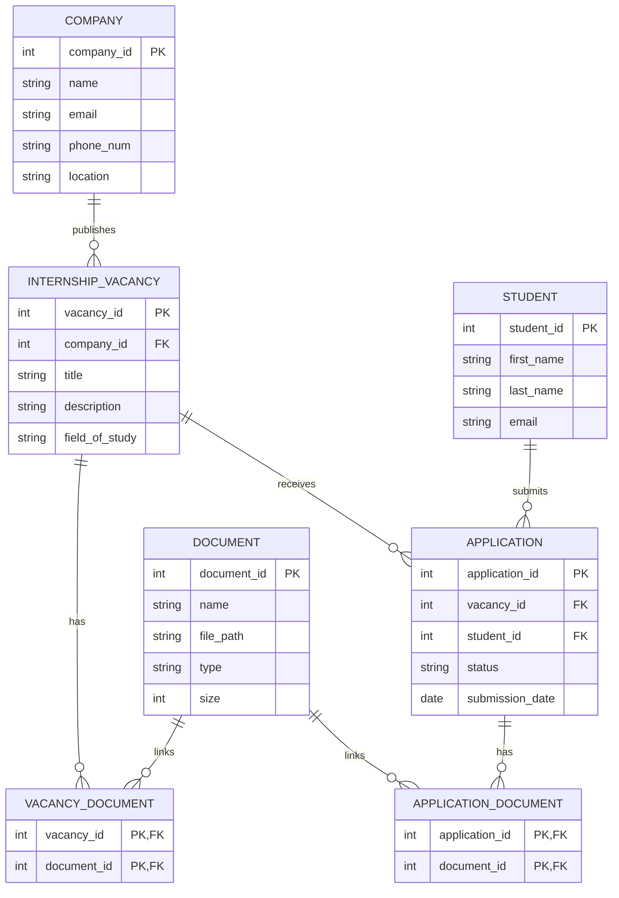
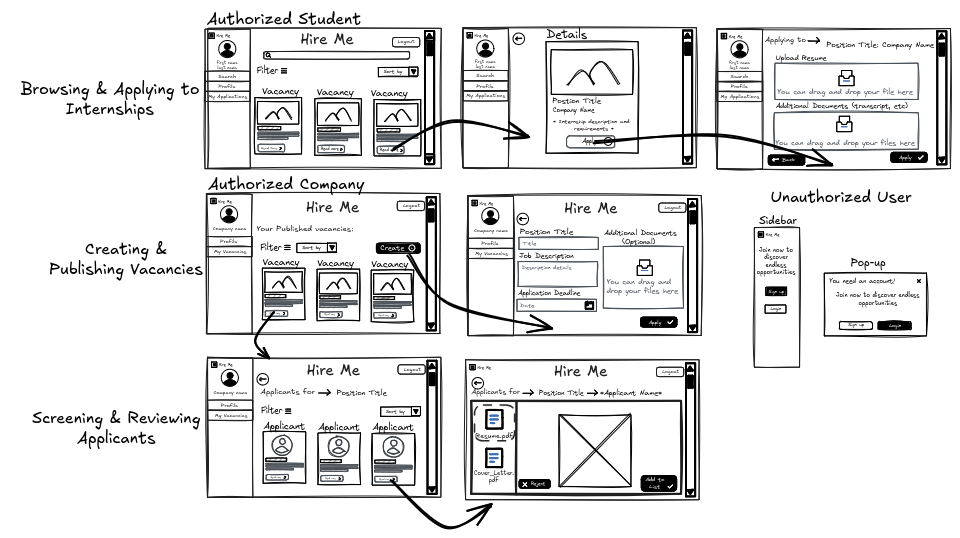

# COMP 3613 Assignment 1

Draft this file with the Guide. **Update it after every phase milestone** before you pause. The use-case diagram is a UML PNG at `docs/diagrams/use-case.png`, linked from this file as `diagrams/use-case.png` (path relative to `docs/report.md`). The model diagram is Mermaid. **Embed wireframe images** as `wireframes/<file>` (files live in `docs/wireframes/`).

Do not put your student ID in this file if you will commit it. The PDF cover adds your name and ID at export time.

## Assigned project

Internship Platform

## Three workflows

### 1. Create and Publish Internship Vacancy (Company)

### 2. Browse Internship Vacancies (Student)

### 3. Screen & Review Applications (Company)

## Use case diagram

Use-case notes: Company starts creating and publishing vacancies and screening applications; Student starts browsing vacancies. Browsing is extended by submitting an application, and submitting an application includes attaching documents. Screening is extended by shortlisting or rejecting applications.

## Model diagram

Phase 3 model draft. Update this section in Phase 5 when polish revises the model, and note what changed.

Model notes: One Company publishes many Internship Vacancies, and each vacancy stores company_id. One Student submits many Applications, and each application stores student_id and vacancy_id. Applications and Documents are many-to-many through Application Document; Vacancies and Documents are many-to-many through Vacancy Document. Both bridge tables use composite primary keys made from their two foreign keys.

## Wireframes

### Internship Platform wireframe overview

Coverage notes:
- Create and Publish Internship Vacancy (Company)
- Browse Internship Vacancies / Submit Internship Application (Student)
- Screen & Review Applications (Company)

The single wireframe covers all named workflows and shows the company-side vacancy management, student-side vacancy browsing and application flow, and company-side application screening flow.

## Theming

The application uses the **HireMe** wordmark. The shared palette uses a `#94B0B7` to `#C2C8C5` page gradient with its blend hint at 65%, dark teal ink, and a `#4a707b` to `#12333F` accent gradient. Fraunces is used for display headings and Source Sans 3 for body text. The landing page, login, register, authenticated header, sidebar, navigation toggle, and welcome badge use the shared brand identity.

## Implementation notes

Phase 5 implementation started with the first named workflow: Create and Publish Internship Vacancy.

The project now includes an `InternshipVacancy` SQLModel, a `VacancyRepository`, a `VacancyService`, a company-side route and template, and a dashboard link that routes through the app’s starter authentication flow. The workflow accepts the vacancy title, description, location, and published state, stores the record against the authenticated user, and renders the company’s vacancy list in the same general UI theme.

Verify notes:
- `python manage.py init` creates the `internshipvacancy` table and seeds the demo accounts.
- `python manage.py run` starts the app successfully on `http://0.0.0.0:5000`.
- Logged in as `bob / bobpass` and confirmed the authenticated company vacancy page loads at `/company/vacancies`.
- Submitted a vacancy form with the real app route and confirmed the listing rendered the created role text, including title and description.

This marks the first working workflow slice; the next polish step is to extend the model and views for the student browsing and application flow.

Polish update: the vacancy form now opens from a dedicated `Create vacancy` button in an accessible Bootstrap modal. The modal keeps the title, location, description, publish toggle, cancel action, and existing save endpoint together without taking space from the company vacancy list.

The modal now also supports an optional vacancy image. The upload field sits to the right of the text form, previews the selected image immediately in the browser, validates JPG/PNG/WEBP files up to 5 MB on the service layer, stores generated filenames under `app/static/uploads/`, and displays the saved image on the vacancy card. Existing databases receive the new optional `image_url` column through the startup schema check.

Seed/migration update: the CLI now creates 20 company users (`company01` through `company20`) and 4 published vacancies per company (80 total) across 20 disciplines. Company passwords follow the matching pattern `company01pass` through `company20pass`. Seeding is idempotent.

Card layout update: each company receives a generated branded SVG profile image under `app/static/img/company_profiles/`. Vacancy cards now use a responsive four-column layout on wide screens and collapse for smaller screens. A vacancy's uploaded image is displayed first; when no vacancy image exists, the card displays the logged-in company's profile image. The `profile_image_url` user field is migrated automatically for existing databases.

Profile workflow update: the authenticated sidebar now includes a Profile tab linking to `/company/profile`. Companies can edit their company name, email, phone, location, and profile image. The page provides a live image preview, validates the same supported image types and 5 MB limit as vacancy uploads, and saves changes through the user service and repository layers. Existing company records were migrated and backfilled with their seeded names, locations, and profile images.

Vacancy editing update: each vacancy card now includes an Edit button that reuses the create-vacancy modal. Edit mode pre-fills the title, location, description, publish state, and current vacancy image; the company can replace the image or leave it unchanged. The update route verifies ownership through the vacancy service before persisting changes.

Status update: the vacancy modal now uses a shared status dropdown in both create and edit modes with `Published`, `Closed`, and `Draft` options. The explicit status is persisted and migrated from the previous boolean publish field; only `Published` vacancies are returned by the public vacancy repository query.

Workflow 2 browse slice implemented: the student browse route calls `InternshipService`, which calls `InternshipRepository` to return published vacancies with title, description, and location search plus pagination. The student browse page presents the opportunities in a responsive card grid, and the authenticated navigation exposes Browse internships only to student-role users. Application submission is the next slice and will enforce the existing one-application-per-vacancy constraint.

Student seed/migration update: the CLI now creates 50 student accounts (`student01` through `student50`) with matching password patterns (`student01pass` through `student50pass`). Each student receives a remote generic avatar URL from `i.pravatar.cc`. The demo dataset targets 10 randomly distributed applications per vacancy across 80 published vacancies, with linked generic PDF records sourced from the W3C dummy PDF test asset. Seeding is idempotent and preserves real uploaded applications.

Application submission slice implemented: each student vacancy card now opens an Apply modal requiring one PDF document (up to 10 MB). The POST route delegates to `InternshipService`, which checks student role, confirms the vacancy is still Published, rejects an existing student/vacancy application, validates the PDF signature and size, then asks `ApplicationRepository` to atomically create the Application, Document, and ApplicationDocument bridge. The database unique constraint remains the final duplicate-application guard. Uploaded resumes are stored under `app/uploads/applications/`, outside public static serving. After redirect, submitted vacancies display an `Application submitted` state. No schema migration was required because the existing tables already represent applications and documents.

Verification status: static diagnostics passed for the updated application repository, internship repository/service, route, and student browse template; the apply route is registered and the FastAPI app imports. The student should run `python manage.py run`, sign in as a student, apply to one Published listing with a PDF, confirm the card changes to `Application submitted`, then try that same vacancy again and confirm the duplicate warning. Also check a non-PDF and a file over 10 MB are rejected.

Workflow 2 detail polish: each browse card now has a View details action leading to `/internships/{vacancy_id}`. The detail page shows the published vacancy description, company identity, and supplementary documents linked through `VacancyDocument`. Each document download route verifies the document belongs to that Published vacancy; HTTP(S) documents redirect to their source, while local files are served only from the application's approved upload directories. The page shows an explicit empty state when no supplementary files are attached. Diagnostics and route-registration checks passed; browser verification is pending student observation.

Student profile update: the student sidebar now includes a Profile tab linking to `/student/profile`. Students can edit first name, last name, email, and education level/program, and replace their profile picture with a live preview. Profile edits use a student-specific schema, service validation, and repository update; uploaded avatars use the shared image validation and are stored separately from company profile uploads. Diagnostics passed and both student profile routes are registered. Browser verification is pending student observation.

Education-level update: the student Profile field now represents current study stage or completed qualification, not program/major. Seeded values include `3rd Year Undergraduate`, `2nd Year Postgraduate`, and `Associate's Degree Graduate`. The idempotent seed command backfilled the 10 existing student accounts with these values without creating duplicate seed records.

Student application tracking update: the student home page's View Applications panel now links to `/student/applications`, and the student sidebar includes a My applications tab. The page lists only the signed-in student's applications with vacancy/company, submission date, status, attached document names, pagination, and an empty state. Application data is fetched through the application service and repository. Diagnostics passed and the route is registered; browser verification is pending student observation.

Theme polish: the shared stylesheet now maps Bootstrap body, text, link, primary/secondary, status, form, card, pagination, and alert colors to the Internship Platform tokens. Shared headings use Fraunces and body text uses Source Sans 3. Authenticated-page surfaces and the expired-session page now use brand colors instead of the previous gray/blue defaults; the dark `/config` admin console retains its separate utility styling.

Background polish: public, authentication, authenticated, and expired-session pages now share the `#94B0B7` to `#C2C8C5` brand gradient, with the CSS color hint shifted to 65%.

Applicants distribution fix: the demo seeder previously assigned every student the same first three globally sorted vacancies, leaving the other companies' Applicants pages empty. Seed assignments now rotate across three distinct company groups per student. Existing obsolete demo applications are identified by the seeder's dummy-PDF URL and replaced; real uploaded application documents are preserved. Migration results: 28 obsolete demo applications replaced, 2 retained, and 30 total applications distributed as 3 per seeded company. A repeat seed replaced or created 0 applications.

Workflow 3 (Screen & Review Applications) started. Company reject / shortlist outcomes will live on `Application.status`.

<!-- student-build:code-check
workflow: Screen & Review Applications (Company)
form: choice
layer: model
architecture_ok: yes
implement_confidence: 0.82
passed: yes
note: Chose Application.status for Submitted / Shortlisted / Rejected
-->

<!-- student-build:code-check
workflow: Screen & Review Applications (Company)
form: snippet
layer: model
architecture_ok: yes
implement_confidence: 0.84
passed: yes
note: Filled Application screening statuses; added Under Review in addition to Submitted/Shortlisted/Rejected
-->

<!-- student-build:code-check
workflow: Screen & Review Applications (Company)
form: snippet
layer: router
architecture_ok: yes
implement_confidence: 0.86
passed: yes
note: Thin company applications GET constructs ApplicationService + ApplicationRepository; no SQL in the route. Glue passed vacancy_id into browse.
-->

Workflow 3 list/review slice implemented: company vacancy cards link to applicants for that vacancy; ApplicationService checks company ownership then lists or updates Application.status to Shortlisted or Rejected; review page shows attached documents plus Reject / Add to shortlist.

Workflow 3 polish: the company Applicants page now filters by `Undergraduate`, `Postgraduate`, `Associate's`, or `Diploma` as well as applicant-name search. A selected category matches case-insensitively when it appears anywhere in the student's education-level text (for example, `3rd Year Undergraduate`). Both filters are preserved while paging; no schema migration is required. Browser verification is pending student observation.

Company vacancy cards now show each vacancy's applicant total in a badge at the bottom-right of its image. Counts come from one grouped repository query per company and include applications across all statuses; no schema migration is required.

Navigation polish: the shared authenticated sidenav now starts collapsed on first visit for both student and company pages. The menu toggle opens and closes it, persists that preference across page navigation in browser storage, and updates its accessible label and expanded state.

Sidebar scroll polish: the authenticated sidenav now stays pinned to the viewport while page content scrolls and can scroll internally when its links exceed the available height.

Student application management polish: My applications now provides an Edit action to replace the attached PDF and a Delete Application action. Both routes enforce student ownership; editing preserves review status, and deletion removes the application/document links while retaining any document still shared elsewhere. Browser verification is pending student observation.

Application edit rule: students may replace an attached PDF only while their application status is `Submitted`. The service checks ownership and status before storing the upload, and the repository rechecks the status during replacement. Under Review, Shortlisted, and Rejected applications are not editable; deletion remains available.

Student application page polish: My applications now uses the same responsive image-card format as Browse Internships, including vacancy/company imagery, details, status, attached documents, and bottom-aligned application actions.

Company applicants page polish: added an `Applications` back button that returns to the company vacancy manager.

Company applicants layout polish: applicant cards now follow the company vacancy card format with a responsive four-column grid, 4:3 profile image area, matching padding and status placement, and a separated Review action footer. A placeholder image is shown when a student has no profile photo.

Workflow 3 review controls: the Applicants page can prioritize Rejected, Shortlisted, or Under Review applications, while retaining newest-first order within the selected status group. `Finish Review` changes only remaining Under Review applications for that company-owned vacancy to Rejected, confirms before submission, reports the number changed, and preserves the current search/sort/page context.

Applicants filter polish: applicant-name search, education-level selection, and status sorting are now grouped in a modal opened by the `Filters` button. The modal retains active values and offers Apply filters, Clear filters, and Cancel actions; Finish Review remains directly available on the page.

Student browse filter revision: vacancies now have a structured `field_of_study` value based on the existing seeded discipline categories. The startup migration adds the nullable column and backfills seeded vacancies from their existing discipline descriptions; legacy vacancies without a recognizable discipline remain unclassified and are available under All fields.

Application status rules: company shortlist and reject actions set `Application.status` to `Shortlisted` and `Rejected`, respectively. When a vacancy transitions into `Closed`, all applications for it are set to `Under Review` in the same database transaction as the vacancy update. Reopening and closing it again repeats this transition. No schema migration is required.

Review-data migration: `python manage.py randomize-review-statuses` randomly closed 40 of 80 vacancies. Each closed vacancy now has exactly 4 Rejected, 3 Shortlisted, and 3 Under Review applications. The other 40 vacancies remain Published and their 400 applications remain Submitted. Database readback confirmed there were no closed-vacancy status-count mismatches. The command requires at least 7 applications per vacancy and refuses to rerun after any vacancy is Closed, preventing accidental reshuffling.

Vacancy status guard: a `Published` vacancy with one or more applications cannot be changed to `Draft`. Submitted title, description, location, and image edits still save; the company receives a warning that its status remains `Published`. Published vacancies without applications and other status transitions retain existing behavior.

Phase 5 final visual polish: the public/authenticated product wordmark is now HireMe. The authenticated header centers the brand title and places the navigation toggle and welcome badge at opposite sides; the company and student dashboards use simplified workflow headings and primary actions. Student Browse Internships and My Applications use responsive four-column card grids on wide screens, reducing to three columns below 1400px, two below 992px, and one on narrow screens. The internship detail backlink now uses the primary button style and has a unique link identity rather than reusing the sidebar toggle ID.

Phase 5 closeout checks: diagnostics pass for the latest changed CSS/templates, the FastAPI app imports, and all updated Jinja templates compile. The student should refresh the app and confirm the latest visual polish in the browser before beginning Phase 6 deployment; this visual confirmation is not recorded here.

## Deployed app

Phase 6. Public Render URL (not localhost). Markers open this to mark the three workflows.

Deployment method: manual Render setup.

Public URL: https://comp3613a1-xr31.onrender.com

Health check: manually confirmed `GET /health` returns `{"ok":true}`.

## Logins

Seeded marker accounts:

- Students: `student01` through `student50`; passwords follow `student01pass` through `student50pass` (example: `student25 / student25pass`).
- Companies: `company01` through `company20`; passwords follow `company01pass` through `company20pass` (example: `company16 / company16pass`).

## YouTube URL

## Session transcripts

Filled when the Guide builds the report: the agent writes each Guide chat to `docs/transcripts/<slug>.md` (Copilot Agent, Cursor, or OpenCode). `python manage.py report` packages them. Do not paste chats here during the build.

## Competency (student-judge)

Filled when the report is built. Guide runs student-judge, writes `docs/judge.md`, and export appends the scorecard here.

## Skill integrity

Filled by `python manage.py report`. Do not edit the course skills.
